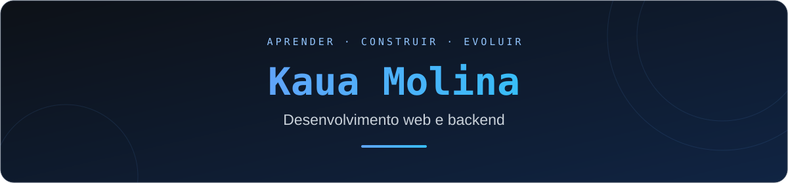

  

<h3 align="center">Estudante de Engenharia de Software · Java · PHP · MySQL</h3>

Transformando aprendizado em sistemas web, projetos práticos e novas possibilidades.

  
  
  

---

## 👨‍💻 Sobre mim

Olá! Sou **Kaua Molina**, estudante de **Engenharia de Software** com foco em **desenvolvimento web e backend**.

Tenho direcionado meus estudos para **Java, PHP e bancos de dados**, aplicando esses conhecimentos em projetos de cadastro, gestão e aplicações interativas. Gosto de entender como as partes de um sistema se conectam, da interface à persistência dos dados.

Busco minha **primeira oportunidade na área de desenvolvimento**, para contribuir com projetos reais, aprender com a equipe e evoluir como desenvolvedor.

- 🎓 **Formação:** Engenharia de Software em andamento.
- 🔧 **Prática:** lógica de programação, operações CRUD e sistemas web.
- 🌱 **Foco de estudo:** backend, organização de código e integração com banco de dados.
- 🤝 **Interesse profissional:** oportunidades de estágio e início de carreira em desenvolvimento.

## 🛠️ Tecnologias e ferramentas

Tecnologias que estudo e utilizo nos meus projetos:

**Backend e linguagens**

**Interfaces web**

**Banco de dados e versionamento**

## 🚀 Projetos em destaque

<table>
  <tr>
    <td width="50%" valign="top">
      <h3 align="center">🔧 Assistência Gtech</h3>
      

      
Sistema em desenvolvimento para gestão de assistência técnica, com foco atual no controle de estoque, movimentações e histórico de peças.

      
<strong>Prática:</strong> API com Java e Spring Boot, persistência em MySQL e integração com uma interface React e TypeScript.

      
<a href="https://github.com/Molinexxx/Assistencia-Gtech">Ver repositório →</a>

    </td>
    <td width="50%" valign="top">
      <h3 align="center">💈 Sistema para Barbearia</h3>
      

      
Sistema web voltado à gestão de uma barbearia, com foco em cadastros, organização de atendimentos e rotinas administrativas.

      
<strong>Prática:</strong> operações CRUD, persistência de dados e organização dos fluxos do sistema.

      
<a href="https://github.com/Molinexxx/project-barbearia">Ver repositório →</a>

    </td>
  </tr>
  <tr>
    <td width="50%" valign="top">
      <h3 align="center">🧠 Jogo da Memória</h3>
      

      
Jogo da memória com emojis, comparação de pares, contador de tentativas e opção de reiniciar a partida.

      
<strong>Prática:</strong> controle de estado com sessões PHP e implementação das regras do jogo.

      
<a href="https://github.com/Molinexxx/Jogo_da_memoria">Ver repositório →</a>

    </td>
    <td width="50%" valign="top">
      <h3 align="center">🌐 Portfólio Dev</h3>
      

      
Meu espaço para apresentar projetos, estudos de caso e evolução técnica, com integração à API do GitHub.

      
<strong>Prática:</strong> interfaces responsivas, consumo de API, cache local e publicação com GitHub Pages.

      
<a href="https://molinexxx.github.io/Portifolio.dev/">Acessar portfólio →</a>

    </td>
  </tr>
</table>

<a href="https://github.com/Molinexxx?tab=repositories">Explore todos os meus repositórios</a>

## 🎯 Meu foco agora

> Consolidar minha base em Java e PHP, conectar aplicações a bancos de dados e construir sistemas cada vez mais organizados e funcionais.

- Aprofundar fundamentos de backend e lógica de programação.
- Evoluir os projetos com atenção à estrutura do código e aos fluxos de uso.
- Documentar soluções e compartilhar minha evolução pelo GitHub e pelo portfólio.

---

<h3 align="center">Vamos conversar?</h3>

  Estou em busca de oportunidades para aprender, colaborar e iniciar minha trajetória profissional em desenvolvimento.
    
  <a href="https://www.linkedin.com/in/kaua-molina-518570314/">LinkedIn</a> ·
  <a href="https://molinexxx.github.io/Portifolio.dev/">Portfólio</a> ·
  <a href="https://github.com/Molinexxx">GitHub</a>

